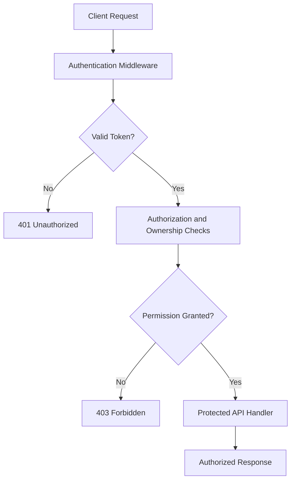

# 🛡️ UW Student Portal – Access Control Security

> Breaking insecure access controls, implementing secure
> authorization, and validating security through automated testing.


---

## 📌 Project Overview

Security is not just about allowing users to log in.
It is about ensuring that every user can access only
the resources they are authorized to use.

This project demonstrates the identification,
exploitation, remediation, and verification of
seven access-control vulnerabilities in a simulated
university student portal.

The vulnerable application was transformed into
a more secure backend using authentication,
authorization, ownership verification, and
Role-Based Access Control (RBAC).

---

## 🎯 Project Achievements

| Security Metric | Result |
|---|---|
| Vulnerabilities Demonstrated | 7 |
| Vulnerability Fixes Verified | 7 |
| Secure Automated Tests | 13 Passed |
| Vulnerable Automated Tests | 7 Passed |
| Total Automated Tests | 20 Passed |
| Failed Tests | 0 |
| Manual Verification Cases | 8 Passed |
| User Roles Implemented | 3 |

---

## 🔐 Security Architecture



The application verifies user identity and applicable
permissions before performing protected operations.

---

## 👥 Role-Based Access Control

The system implements three roles with different
access permissions, following the principle
of least privilege.

| Permission | Student | Teacher | Admin |
|---|:---:|:---:|:---:|
| View Own Result | ✅ | ✅ | ✅ |
| View All Results | ❌ | ✅ | ✅ |
| Update Own Profile | ✅ | ✅ | ✅ |
| Download Reports | ❌ | ✅ | ✅ |
| View Admin Panel | ❌ | ❌ | ✅ |
| Manage Users | ❌ | ❌ | ✅ |

---

## ⚠️ Vulnerability Assessment

Seven access-control vulnerabilities were identified
and demonstrated in the vulnerable application.

| ID | Vulnerability | CWE | Security Impact |
|---|---|---|---|
| V1 | Missing Authentication | CWE-306 | Unauthenticated access |
| V2 | IDOR | CWE-639 | Unauthorized result disclosure |
| V3 | Missing Role Check | CWE-862 | Unauthorized admin access |
| V4 | Role Tampering | CWE-807 | Privilege escalation |
| V5 | Mass Assignment | CWE-915 | Unauthorized role modification |
| V6 | Path Traversal | CWE-22 | Unauthorized file access |
| V7 | Missing Delete Authorization | CWE-862 | Unauthorized user deletion |

---

## 🛠️ Security Remediation

| ID | Implemented Security Fix |
|---|---|
| V1 | Authentication middleware |
| V2 | Record ownership and permission verification |
| V3 | Admin-only permission enforcement |
| V4 | Server-side role verification |
| V5 | Allowlisting editable profile fields |
| V6 | Restricting access to the allowed report file |
| V7 | Admin-only user deletion permission |

---

## 📊 Before vs After Security Implementation

| Vulnerability | Before Fix | After Fix |
|---|---|---|
| Missing Authentication | 200 OK | 401 Unauthorized |
| IDOR | Result Disclosed | 403 Forbidden |
| Missing Role Check | Admin Access Allowed | 403 Forbidden |
| Role Tampering | Fake Role Accepted | 403 Forbidden |
| Mass Assignment | Role Changed to Admin | Role Remained Student |
| Path Traversal | File Disclosed | 403 Forbidden |
| Unauthorized Deletion | User Deleted | 403 Forbidden |

All seven vulnerability-fix checks passed.

---

## 🧪 Automated Security Testing

Jest and Supertest were used to perform positive
and negative security testing.

### Positive Testing

Verifies that authorized users can successfully
access permitted resources.

### Negative Testing

Verifies that unauthorized requests are rejected
by the implemented security controls.

| Test Suite | Passed | Failed |
|---|:---:|:---:|
| secure.test.js | 13 | 0 |
| vulnerable.test.js | 7 | 0 |
| **Total** | **20** | **0** |

### Actual Test Summary

```text
Test Suites: 2 passed, 2 total
Tests:       20 passed, 20 total
```

Passing vulnerable tests confirm that the original
security weaknesses can be reproduced.

Passing secure tests confirm that the tested
access-control rules behave as expected.

---

## 🔍 Manual Security Verification

| Case | Security Scenario | Actual Result |
|---|---|---|
| A | Student reads own result | 200 OK |
| B | Teacher reads another result | 200 OK |
| C | Student reads another result | 403 Forbidden |
| D | Student accesses admin users | 403 Forbidden |
| E | Request without authentication | 401 Unauthorized |
| F | Fake admin role | 403 Forbidden |
| G | Unauthorized role modification | Role unchanged |
| H | Unauthorized user deletion | 403 Forbidden |

---

## 📂 Backend Project Structure

```text
SSDD/
├── src/
│   ├── data.js
│   ├── policies.js
│   ├── auth.js
│   ├── app.js
│   └── vulnerable-app.js
├── tests/
│   ├── secure.test.js
│   └── vulnerable.test.js
├── reports/
│   └── summary.txt
├── server.js
├── server-vuln.js
├── package.json
├── .gitignore
└── README.md
```

---

## 💻 Technologies and Tools


- JavaScript
- Node.js and Express.js
- Jest and Supertest
- curl
- Visual Studio Code
- Git and GitHub

---

## 🚀 Getting Started

### Install Dependencies

```bash
npm install
```

### Start Secure Application

```bash
npm start
```

### Start Vulnerable Application

```bash
npm run start:vuln
```

Run only one server at a time.
Use the vulnerable application in an isolated
local educational environment only.

### Run Automated Tests

```bash
npm test
```

---

## 🚧 Security Limitations

This project is an educational security demonstration,
not a production-ready authentication system.

Current backend limitations include:

- Hard-coded demonstration tokens
- No password hashing
- No token expiration
- No HTTPS
- No rate limiting
- No security audit logging
- In-memory data storage

A production implementation would require stronger
authentication, persistent storage, secure session
management, and additional security controls.

---

## 🎓 Learning Outcomes

Through this project, I gained practical experience in:

- Identifying access-control vulnerabilities
- Implementing authentication and authorization
- Designing role-based access-control policies
- Preventing privilege escalation
- Securing backend API routes
- Performing automated security testing
- Verifying security through manual testing
- Documenting security assessments

---

## 🏫 Academic Information

**University:** University of Wah

**Department:** Cyber Security

**Course:** Secure Software Development

**Lab:** Lab 07 – Access Control

---

## 🏁 Conclusion

This project demonstrates how insecure access-control
mechanisms can be identified, remediated, and verified
through structured security testing.

The implemented controls successfully passed all
20 automated tests and the eight manual verification
cases.

> Security is not only about verifying who a user is,
> but also controlling what that user is allowed to do.

---

⭐ Built with a security-first mindset.
